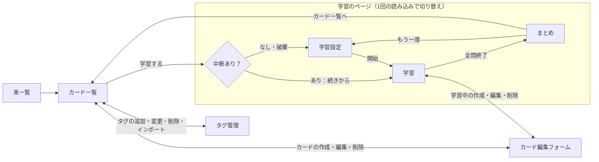

# 暗記カードアプリ（Anki モジュール）要件定義

最終更新: 2026-11-10

## 概要

暗記カードの束を作り、条件を絞って出題・学習できる機能を、既存アプリに `Anki` モジュールとして追加する。データは最終的に DB（MySQL）に保存し、ログインユーザー本人だけが参照できる。

- **技術構成**：既存の Slim 4 + Latte + htmx + Alpine.js を使う。React / Next.js は導入しない。ブラウザ側の JS は esbuild でまとめる
- **認証**：既存の GitHub / Google ログインを使う。全データを `user_id` で絞り込む
- **重視すること**：学習中の時間を最優先する。学習中の操作は、どれも通信の結果を待たない。見た目の演出より軽快さと操作性を優先する

## 基本方針：学習を始めたら、通信なしで最後まで続けられる

束一覧とカード一覧は、サーバーで描画する通常のページにする。学習のページ（学習設定・学習・まとめ）だけは、学習を始めた時点で必要なデータを手元にそろえ、以降の変更はまず画面に反映して、サーバーへの送信は裏で行う。

| タイミング | 通信 | 内容 |
| --- | --- | --- |
| 束一覧・カード一覧 | あり（応答を待つ） | 通常のページ（htmx）。カード一覧はスクロールに合わせて100件ずつ読み込む。検索・フラグ・カードの作成・編集・削除・タグの変更は、サーバーの応答を待って画面に反映する |
| 学習設定を開いたとき | あり（待ってよい） | 束の全カードの軽い情報（`uuid`、向きごとの状態、タグ）と中断セッションを取得する。本文は取らない |
| 学習を始めたとき | あり（待ってよい） | 出題するカードの本文だけを取得する |
| 学習中 | **待たない** | フラグ・進捗・カードの新規作成・編集・削除は、画面にすぐ反映して送信待ちの列（端末）に積む。送信は裏で行い、失敗したら電波が戻ってから再送する |
| 学習の終了時 | 待たない | まとめは手元のデータから計算して即座に表示する。セッションの削除も送信待ちの列に積むだけ |
| その後 | あり（時間がかかってよい） | 未送信のものを送り切る。画面に「未送信 n 件」を表示する |

- 学習を始めたあとは、圏外になっても学習を最後まで続けられる。束一覧・カード一覧・学習設定は、通信できることを前提にする
- 端末に保存するのは送信待ちの操作だけ。カードのデータは端末に持ち続けない
- 最終的にはサーバーに保存されるので、PC とスマホで同じデータを使える

## 機能要件

### 束（デッキ）

- 束を複数作成・名前変更・削除できる
- 束を削除すると、配下のカード・タグ・中断セッションもまとめて削除する。端末に残っているその束の送信待ちの操作も消す
- 削除の前に確認ダイアログを出す。束の名前の入力までは求めない
- 1つの束に数百〜数千枚のカードが入ることを想定する

### カード

- 表と裏はそれぞれ何行でも書ける。保存形式はマークダウン
- WYSIWYG で編集できる。画像・コードブロック・数式を使える
- 面ごとにフォントサイズを `large`（既定）/ `normal` / `small` から選べる。情報量が多い面だけ小さくする用途
- タグを複数付けられる
- 新規作成・編集・削除は、カード一覧と学習中のどちらでも同じことができる（同じフォーム部品を使う）
- 学習中は、保存ボタンを押したら通信を待たずにすぐモーダルを閉じる。カード一覧では、サーバーの応答を待ってから閉じる
- 入力中の内容は下書きとして端末に自動保存する

### フラグ（暗記状態）

- 向き（表→裏、裏→表）ごとに状態を持つ
- 状態は「未設定」「暗記済み」「苦手」の3つで、暗記済みと苦手は排他
- ユーザーが手動で切り替える。自動判定はしない。同じフラグをもう一度押すと未設定に戻る
- 操作できる場所は、学習中（今の向きに対して）とカード一覧（両方の向き）

### タグ

- 束ごとに管理する。同じ束の中で名前は重複させない
- 他の束からタグ名だけをインポートできる。カードとの紐付けはコピーしない。同名のタグはスキップする
- タグの名前を、すでにある別のタグの名前に変更した場合は、2つのタグを統合する

### 出題設定

| 項目 | 選択肢 |
| --- | --- |
| 向き | 表→裏 / 裏→表（1セッションの中で混ぜない） |
| 対象 | すべて / 暗記済みを除く（未設定と苦手） / 苦手のみ。選んだ向きの状態で判定する |
| タグ | 複数選択でき、AND / OR を切り替える。1つも選ばなければ絞り込みなし |
| 順序 | シャッフル / 登録順 / 登録逆順 |
| 枚数 | 数値で入力する。順序を適用したあとの先頭 N 枚を取る。0・未入力は全部。該当の件数より多ければ該当の件数で止める |

- 設定を変えると、その場で「該当 n 件 / 出題 m 件」を更新する。学習設定を開いたときに取得した軽い情報で計算するので通信はない。0件のときは開始ボタンを無効にする

### 学習セッション

- 開始時に、出題するカードの並び（`uuid` の配列）を端末で確定し、そのカードの本文を取得する。以降のフラグ変更やタグ変更は、そのセッションの出題に影響させない
- カードは「1枚目の問題の面 → 1枚目の答えの面 → 2枚目の問題の面 → …」の1本の並びとして、1歩ずつ進む。向きが表→裏なら問題の面は表、裏→表なら裏
- カードをタップ（クリック）すると、瞬時に1歩進む。切り替えの演出は入れない。「次へ」ボタンは置かない
- 「戻る」ボタンで1歩戻る。問題の面から戻ると、前のカードの答えの面を表示する。戻ったカードでもフラグの変更や編集ができる。最初のカードの問題の面では無効にする
- 最後のカードの答えの面でタップすると、まとめへ移る
- カードの文字は、ドラッグやダブルクリックで選択できないようにする。タップで進む操作とぶつからないようにするため
- 表示は大きめの文字・左寄せ・縦中央。長い内容は上から通常どおりスクロールする（`margin-block: auto`）。表と裏で高さは揃えない
- 学習中の「中断」ボタン（赤）で、学習を途中でやめて学習設定に戻る
- 束ごとに中断セッションを1つ保持する。束の学習を始めようとすると「続きから」「破棄して最初から」の2択を出す
- 中断セッションはサーバーから取得する。端末に未送信のセッションの更新があれば、更新時刻が新しい方を使う
- 再開するときは、残りのカードの本文を取り直す（通信が必要）。中断中に削除されたカードはスキップし、編集されたカードは最新の内容を出す
- 最後まで終えたらまとめを表示し、セッションを削除する。まとめには出題数と、そのセッション中に暗記済み・苦手にした枚数を出す

### キーボード操作（PC）

| キー | 操作 |
| --- | --- |
| Space / → / Enter / J / L | 1歩進む（タップと同じ） |
| ← / K / H | 1歩戻る（「戻る」と同じ） |
| M / D | 暗記済みの切り替え |
| W | 苦手の切り替え |
| E | 今のカードを編集 |
| N | カードを新規作成 |
| Esc | 編集を閉じる（未保存なら確認） |
| Ctrl / ⌘ + Enter | 編集中に保存する |

- 入力欄やエディタにフォーカスがある間は、学習用のショートカットを無効にする
- キーは `event.code`（キーボード上の位置）で判定する。日本語入力がオンのままでも反応させるため
- Ctrl / ⌘ / Alt と一緒に押されたキーは無視する（`⌘ + ←` などのブラウザの操作を奪わない）
- キーの押しっぱなし（`event.repeat`）は無視する。何枚も進んでしまわないようにするため
- ショートカットのキーは、フォーカスのあるボタンより優先する（`preventDefault()`）。ボタンをクリックしたあとに Space を押したとき、ボタンが押し直されないようにするため。その代わり、Tab でボタンに移って Enter で押す操作はできない

### 同期

- 対象は学習中の操作だけ。カード一覧の操作は、その場でサーバーの応答を待つ
- 送信待ちの操作は端末（IndexedDB）に記録し、記録した順にサーバーへ送る
- 送るタイミングは、操作を記録したとき、`online` イベント、画面が隠れたとき（`visibilitychange`）、失敗後の再試行（間隔を1秒から最大60秒まで延ばす）
- 未送信の件数を画面の隅に小さく表示する
- 同じブラウザを複数のアカウントで使っても混ざらないよう、端末のデータはユーザー ID ごとに分ける
- ログアウト時に未送信の操作があれば警告する。ログアウトしたら、その端末のデータを消す

## 画面一覧

束一覧とカード一覧は、サーバーで描画する通常のページ。カード一覧の「学習する」で学習のページへ移る。学習のページは1枚のページの中で、学習設定・学習・まとめの3つの表示を切り替える。学習を始めたあとはページを読み込み直さないので、圏外でも続けられる。

| 画面 | 主な内容 | 備考 |
| --- | --- | --- |
| 束一覧 | 束の作成・名前変更・削除。各束のカード枚数、中断セッションの有無 | サーバーで描画（htmx）。サイドバーに「暗記カード」を追加 |
| カード一覧（束のページ） | カードの一覧。表の冒頭（マークダウンを除いた平文の1行）、タグ、向きごとの状態バッジを表示。フラグの切り替え、新規作成・編集・削除、検索 | 束を開いて最初に出る画面。サーバーで描画（htmx）し、スクロールに合わせて100件ずつ読み込む。「学習する」で学習のページへ |
| 学習のページ：学習設定 | 向き・対象・タグ（AND / OR）・順序・枚数。「該当 n 件 / 出題 m 件」を即時に更新 | 開いたときに全カードの軽い情報を取得する。中断セッションがあれば、先に「続きから / 破棄して最初から」を出す |
| 学習のページ：学習 | カード表示、進捗（例：12 / 30）、今が問題と答えのどちらの面か、「戻る」「中断」「暗記済み」「苦手」「編集」「新規作成」「削除」 | カードのタップで1歩進む。最後のカードの答えの面のあとにまとめへ |
| 学習のページ：まとめ | 出題数、暗記済み・苦手にした枚数 | 「カード一覧へ」「もう一度」（学習設定へ） |
| カード編集フォーム | 表・裏の WYSIWYG エディタ、面ごとのフォントサイズ、タグ、向きごとの状態 | モーダル。スマホでは全画面。一覧と学習で同じ部品を使う |
| タグ管理 | タグの追加・名前変更・削除。他の束からタグ名をインポート | カード一覧のモーダル |

### 画面遷移



中断セッションがあれば「続きから」で学習へ直行し、「破棄して最初から」を選ぶと学習設定へ進む。編集フォームはモーダルで、学習中は保存するとすぐに閉じて元の表示に戻る。タグ管理もモーダルで、カード一覧から開く。

### 学習中の編集で操作性を保つためのルール

- カード一覧と同じフォーム部品を開く。できる操作に差を作らない
- 開いたら、今表示している面（表か裏）のエディタにカーソルを置く
- 保存したらすぐモーダルを閉じ、同じカードの同じ面に戻る。編集内容はその場で表示に反映する。学習の進捗は変わらない
- 学習中に新規作成したカードは束には追加するが、実行中のセッションには入れない（開始時点で固定、という方針に合わせる）
- 今のカードを削除したら、次のカードへ進む

## データモデル

テーブルは6つ。所有者は `anki_decks.user_id` を起点にたどる。テーブル名には `anki_` を付け、他のモジュールと分ける。外部キーはすべて `ON DELETE CASCADE` にする。

| テーブル | 主な列 | 制約・備考 |
| --- | --- | --- |
| `anki_decks` | `id`, `user_id`, `name`, 作成・更新日時 | `user_id` → `users` |
| `anki_cards` | `id`, `uuid`, `deck_id`, `front_md`, `back_md`（MEDIUMTEXT）, `front_size`, `back_size`（`large` / `normal` / `small`、既定 `large`）, `f2b_status`, `b2f_status`（`none` / `memorized` / `weak`、既定 `none`）, `client_updated_at`, `deleted_at`, 作成・更新日時 | UNIQUE(`uuid`)。INDEX(`deck_id`, `id`)。登録順は `id` の昇順 |
| `anki_tags` | `id`, `deck_id`, `name` | UNIQUE(`deck_id`, `name`) |
| `anki_card_tags` | `card_id`, `tag_id` | PRIMARY KEY(`card_id`, `tag_id`)。INDEX(`tag_id`) |
| `anki_images` | `id`, `uuid`, `user_id`, `stored_name`（推測されないランダム名）, `mime`, `size`, 作成日時 | UNIQUE(`uuid`)。ファイル本体は `public/` の外に置く |
| `anki_study_sessions` | `id`, `deck_id`, `settings`（JSON）, `card_uuids`（JSON）, `current_index`, `marked`（JSON）, `client_updated_at`, 作成・更新日時 | UNIQUE(`deck_id`) で束ごとに1つ |

- `uuid` はブラウザ側で発行する。オフラインで作ったカードや画像を、同期前でも識別できるようにするため
- `client_updated_at` は端末で更新した時刻（ミリ秒）。カード本文の編集が競合したら、新しい方を採用する
- カードの削除は `deleted_at` を入れる論理削除にする。送信が遅れて届いた作成や編集で、削除したカードが復活しないようにするため。30日を過ぎた論理削除はバッチで物理削除する
- `updated_at` はフラグやタグの変更でも更新する
- カード一覧の続きの読み込みは、`id` で区切って取得する（`WHERE deck_id = ? AND id > ? ORDER BY id LIMIT 100`）
- 状態は向きが2つで固定なので、別テーブルにせず `anki_cards` の2列で持つ。排他は ENUM の1列で保証される
- `settings` には開始時の出題設定（向き・対象・タグ・順序・枚数）を保存する
- `marked` には「カードの `uuid` → そのセッション中に最後に設定した状態」を記録し、まとめの集計に使う
- 回答ログのテーブルは作らない（暗記の判定が手動のため）
- 既存の `todos` には `user_id` がない。Anki では全クエリを所有者で絞る

## 同期の仕様

学習中の操作を、送信待ちの列から `POST /anki/sync` で送る仕組み。

### 端末での操作のまとめ方

同じ対象への操作は、送る前にまとめる。

| 列にある操作 | 新しい操作 | まとめた結果 |
| --- | --- | --- |
| カードの作成 | 編集 | 最新の内容で作成 |
| カードの作成 | 削除 | 両方とも捨てる（送らない） |
| カードの編集 | 編集 | 最新の内容で編集 |
| カードの編集 | 削除 | 削除 |
| フラグ | フラグ（同じカード・同じ向き） | 最新の状態だけ |
| セッションの更新 | セッションの更新（同じ束） | 最新の位置と `marked` だけ |

### 操作の種類（`POST /anki/sync` で送る）

| 種類 | 主な内容 | サーバーでの扱い |
| --- | --- | --- |
| `card.create` | `uuid`, `deck_id`, 本文, フォントサイズ, タグ名の配列, `at` | `uuid` が既にあれば何もしない（何度送られても1件） |
| `card.update` | `uuid`, 変更した項目, タグ名の配列, `at` | `at` が `client_updated_at` より古ければ無視する。削除済みなら無視する |
| `card.delete` | `uuid` | 論理削除する。既に削除済みなら何もしない |
| `card.status` | `uuid`, `direction`, `status` | 届いた順に反映する |
| `tag.create` / `tag.rename` / `tag.delete` | `deck_id`, タグ名 | 名前で扱う。変更先の名前が既にあれば統合する |
| `session.start` | `deck_id`, `settings`, `card_uuids`, `at` | 既存のセッションを置き換える |
| `session.update` | `deck_id`, `current_index`, `marked`, `at` | `at` が新しいときだけ反映する |
| `session.finish` | `deck_id` | セッションを削除する |

- タグはカードの送信データに名前で含め、サーバー側で「束 × 名前」で登録または取得する。オフラインで作ったタグも ID の対応を気にせずに済む
- 1回のリクエストで届いた操作は、トランザクションの中で順に反映する
- レスポンスで、反映した操作と、検証エラーで拒否した操作を返す。拒否された操作は列から外し、画面で知らせる。通信エラーのときは列に残して再送する
- フラグの競合は、本人が複数の端末で同時に操作することはまれなので、届いた順で十分とする

### 画像

画像はサーバーにアップロードしないと URL が決まらないので、ほかの操作と扱いが違う。

- 貼り付けたら、編集中にすぐ裏でアップロードを始める。多くの場合、保存を押す前に終わる
- 終わっていない、または圏外のときは、画像を IndexedDB に保存して仮の URL で表示し、送信待ちの列に「画像のアップロード」を積む
- カードの同期は、その画像のアップロードが終わってから行う。そのとき、本文の仮の URL を本物に置き換える
- 上限を超える画像は、アップロード前にブラウザ側で縮小する。通信量と端末の保存容量を減らせるので、電波が悪いときにも有利
    - 長辺が 1600px を超えたら 1600px に縮小し、WebP（品質 0.85）に変換する
    - アニメーション GIF は縮小するとアニメーションが失われるので、そのまま扱う
- サーバー側では、縮小後でも 5MB を超えるファイルは拒否する（ブラウザ側の処理を通らない送信への備え）
- 使われなくなった画像は、1日1回のバッチで削除する
    - どのカードの本文（論理削除されたものを除く）からも参照されていない画像が対象
    - アップロードから7日以内の画像は対象外にする。オフラインの端末が、画像だけ先にアップロードしてカードを後から同期する場合があるため

### 大量のカードへの対策

1つの束に数千枚のカードが入っても、学習中の軽快さを保つ。全カードの本文を一度に取得することはしない。

- **カード一覧**：スクロールに合わせて100件ずつ読み込む（htmx の `hx-trigger="revealed"`）。行は平文の1行だけを表示し、マークダウンの描画や KaTeX は使わない。平文の1行はサーバーで作る
- **検索**：サーバーで行う。束で絞ってから探すので、数千件なら十分に速い。結果も100件ずつ読み込む
- **学習設定**：全カードの軽い情報（`uuid`、向きごとの状態、タグ）だけを取得する。1枚あたり数十バイトなので、3000枚でも圧縮して数十KB 程度で済む。件数の計算と出題するカードの選択は、これを使って JS で行う
- **学習の開始**：出題するカードの本文だけを取得する
- **学習**：今のカードと前後の数枚だけを描画する

## URL 設計

すべて `/anki` のグループにまとめ、`AuthMiddleware` を掛ける。他人の束やカードを指定されたら、403 ではなく 404 を返す（存在を漏らさない）。

| メソッド | パス | 内容 |
| --- | --- | --- |
| GET | `/anki` | 束一覧（HTML） |
| POST | `/anki/decks` | 束を作成 |
| PATCH / DELETE | `/anki/decks/{deck}` | 束の名前変更 / 削除 |
| GET | `/anki/decks/{deck}` | カード一覧（HTML。最初の100件） |
| GET | `/anki/decks/{deck}/cards` | カード一覧の続き（HTML の断片）。`?after={id}` で続きの100件、`?q=` で検索 |
| GET | `/anki/decks/{deck}/study` | 学習のページ（HTML。学習設定・学習・まとめを含む） |
| GET | `/anki/decks/{deck}/meta` | 全カードの軽い情報（`uuid`、向きごとの状態、タグ）とタグの一覧、中断セッション（JSON） |
| POST | `/anki/decks/{deck}/cards/bodies` | `uuid` の配列を送り、そのカードの本文を返す（JSON）。数千件の `uuid` は URL に入りきらないので POST にする |
| GET | `/anki/decks/{deck}/importable-tags` | 他の束とそのタグ名（JSON。タグのインポート用） |
| POST | `/anki/sync` | 学習中の操作をまとめて反映（JSON） |
| POST | `/anki/images` | 画像のアップロード（`uuid` 付き。JSON で URL を返す） |
| GET | `/anki/images/{name}` | 画像の配信（所有者のみ） |

- 学習中の操作は、すべて `/anki/sync` を通す
- カード一覧での作成・編集・削除・フラグ・タグの URL は、段取り4で決める（`/anki/sync` を使うか、htmx 用に個別の URL を作るか）
- JSON を受け取る POST は `Content-Type: application/json` だけを受け付ける。他のサイトのフォームからは送れなくなり、CSRF の対策にもなる

## モジュール構成

既存の `Todo` と同じ仕組みで、`app/Anki/routes.php` を置き、`config/routes.php` の `$modules` に `'Anki'` を追加すれば組み込める。管理するものが多いので、中をサブディレクトリに分ける。

```
slim/
  app/Anki/
    routes.php                   # /anki グループ。AuthMiddleware を掛ける
    Deck/
      DeckController.php         # 束一覧、束の CRUD、カード一覧（続きの読み込みと検索）、importable-tags
      DeckRepository.php
    Card/
      CardRepository.php
    Tag/
      TagRepository.php          # 名前での登録・取得、統合
    Study/
      StudyController.php        # 学習のページ、meta、cards/bodies
      StudySessionRepository.php
    Sync/
      SyncController.php         # POST /anki/sync
      SyncService.php            # 操作の検証と、トランザクション内での反映
    Image/
      ImageController.php        # アップロードと、所有者を確かめた配信
      ImageRepository.php
      ImageStorage.php           # ファイルの保存先を抽象化(将来 S3 に差し替え可能)
    Maintenance/
      CleanupCommand.php         # 使われなくなった画像と、期限切れの論理削除カードを消す
    Domain/
      Direction.php              # enum: F2B / B2F
      CardStatus.php             # enum: None / Memorized / Weak
      FaceSize.php               # enum: Large / Normal / Small

  templates/anki/
    deck/index.latte             # 束一覧
    deck/show.latte              # カード一覧
    deck/_rows.latte             # カード一覧の100件分の断片(続きの読み込みと検索で返す)
    study/show.latte             # 学習のページの外枠(Alpine の各表示を含む)
    study/_setup.latte, study/_study.latte, study/_summary.latte
    card/_form.latte             # 一覧と学習で共用する編集フォーム
    tag/_manage.latte

  assets/anki/                   # ブラウザ側 JS のソース(esbuild の入力)
    main.js                      # 入口。Alpine のコンポーネントを登録する
    store.js                     # 学習中のカード(メモリ上)と、送信待ちの列(IndexedDB)。操作を手元のデータに適用する
    outbox.js                    # 操作のまとめ方、送信、再試行
    query.js                     # 対象・タグ(AND/OR)・順序・枚数の絞り込みと件数
    render.js                    # マークダウン → 無害化した HTML
    editor.js                    # Milkdown。必要になったときに読み込む(別ファイルに分割)
    views/setup.js, views/study.js, views/form.js
    shortcuts.js
  package.json                   # Milkdown, unified/remark/rehype, KaTeX, idb, esbuild

  bin/anki-cleanup.php           # CleanupCommand を実行する。cron から1日1回呼ぶ

  public/js/anki/                # esbuild の出力先。Git の対象外
  public/css/anki.css
  storage/anki/images/           # 画像の実ファイル。Git の対象外
```

- ログイン中のユーザー ID は、既存の `AuthMiddleware` が設定する `$req->getAttribute('user_id')` から取る
- Repository のメソッドはすべて `userId` を受け取り、SQL の中で `anki_decks.user_id` を結合して絞る。コントローラーでの確認漏れを構造的に防ぐため
- 他のモジュールから参照するのは `users` テーブルと `Utilities` だけにし、`Anki` はほかのモジュールに依存しない
- 出力した JS は Alpine 本体より先に読み込み、`alpine:init` でコンポーネントを登録する

## 技術選定とリスク

最大のリスクは「エディタで書いた数式や画像が、表示でも同じように見えるか」と「端末とサーバーの同期が正しく動くか」。実装に入る前に小さく検証する。

| 項目 | 採用 | 理由・注意 |
| --- | --- | --- |
| WYSIWYG エディタ | Milkdown（Crepe） | マークダウンが前提で、数式・コード・画像が標準で揃う。React 不要。重いので、編集を開いたときに初めて読み込む |
| マークダウンの表示 | unified / remark / rehype（ブラウザ側） | Milkdown の内部と同じ系統のパーサーなので、エディタと表示の差が出にくい。編集内容を通信なしで即表示できる。`rehype-sanitize` で XSS を防ぐ |
| 数式 | `remark-math` + `rehype-katex` | Milkdown と同じ `$...$` / `$$...$$` の書き方を扱える |
| コードの色付け | `rehype-highlight` | 描画時にまとめて処理する |
| 端末の保存 | IndexedDB（`idb` ライブラリ） | 送信待ちの操作と、圏外で貼り付けた画像を置く。localStorage は容量が約5MB で、画像を置けない |
| ビルド | esbuild | 依存ライブラリを1つのファイルにまとめる。Milkdown は別ファイルに分けて遅延読み込みする。ビルドは compose に追加する Node コンテナで行い、PHP のコンテナには入れない |
| 描画の負荷対策 | 先回りして描画 | 学習中は今のカードと前後の数枚だけを描画しておく。一覧は平文の1行だけを、100件ずつ読み込む |
| 画像の縮小 | Canvas（ブラウザ側） | `createImageBitmap` で読み込み、Canvas で縮小して `toBlob('image/webp', 0.85)` で書き出す |
| シャッフル | JS（Fisher–Yates） | 端末で並びを確定する |
| 件数の即時反映 | JS | 学習設定を開いたときに取得した軽い情報で計算する |
| 画像の配信 | PHP 経由 | 所有者を確認してから返す。`X-Content-Type-Options: nosniff` と `Cache-Control: private` を付ける。アップロードは `finfo` で実体を確認し、JPEG / PNG / WebP / GIF に限る。SVG はスクリプトを含めるので除外 |

タグの AND / OR は、件数の計算と出題リストの作成で同じ関数を使う。

```js
// assets/anki/query.js
export const matchTags = (card, tags, mode) =>
  tags.length === 0 ||
  (mode === 'and'
    ? tags.every((t) => card.tags.includes(t))
    : tags.some((t) => card.tags.includes(t)));
```

### esbuild の導入イメージ

```yaml
# compose.yml に追加(ビルドのときだけ使う)
  node:
    image: node:22-alpine
    working_dir: /app
    volumes:
      - ./slim:/app
    profiles: ["tools"]
```

```json
// slim/package.json の scripts
{
  "scripts": {
    "build": "esbuild assets/anki/main.js --bundle --splitting --format=esm --minify --outdir=public/js/anki",
    "watch": "esbuild assets/anki/main.js --bundle --splitting --format=esm --sourcemap --outdir=public/js/anki --watch"
  }
}
```

```makefile
# Makefile に追加
js:
	docker compose run --rm node sh -c "npm ci && npm run build"
js-watch:
	docker compose run --rm node npm run watch
```

### 実装前に検証すること

- [ ] esbuild でまとめた JS から Crepe を遅延読み込みし、Alpine のモーダルの中でマークダウンを読み書きできるか
- [ ] Crepe で書いた数式・コード・画像を remark / rehype で描画し、エディタと同じ見た目になるか
- [ ] IndexedDB と送信待ちの列の試作。学習を始めたあと DevTools でオフラインにして、操作 → 再接続 → 同期の流れが通るか
- [ ] 画像を貼り付け、オフラインで保存し、再接続後にアップロードとカードの同期が正しい順で行われるか
- [ ] 3000枚程度のダミーデータで、学習設定での軽い情報の取得時間、学習の開始時の本文の取得時間、カード一覧のスクロール、検索の速さを測る

## 実装フェーズと未決事項

> 下のフェーズは当初の案。実際に作る順番と進み具合は [roadmap.md](roadmap.md) に従う（2026-11-07 に順番を変更）。

カードはマークダウンで保存するので、最初は「テキスト入力とプレビュー」で作り、あとから WYSIWYG に差し替える。同期の仕組みは土台の段階で作り、以降のすべての操作がそれに乗るようにする。

1. **検証**：「実装前に検証すること」の5項目
2. **土台**：マイグレーション、esbuild のビルド環境、束一覧と束の CRUD、`data`（差分取得を含む）と `sync` の API、端末の保存と送信待ちの列、未送信件数の表示、カード一覧（テキスト入力とプレビュー、スクロールに合わせた描画）、タグ、フラグ
3. **学習**：出題設定と件数の即時反映、学習画面（タップで進む・戻る）、学習中の作成・編集・削除、中断と再開、まとめ、キーボード操作
4. **リッチな編集**：Milkdown への差し替え、画像の縮小・アップロード・配信（オフライン時の扱いを含む）、数式、コードの色付け
5. **仕上げ**：タグのインポート、掃除のバッチ（使われなくなった画像、期限切れの論理削除カード）
6. **将来**：PWA 化（Service Worker で、完全に圏外の状態からでもアプリを開けるようにする）

### 未決事項

- 掃除のバッチを動かす場所（Docker のコンテナ内の cron か、ホストの cron か、デプロイ先のスケジューラーか）。デプロイ先が決まってから決める
- カード一覧での作成・編集・削除・フラグ・タグの送り方（`/anki/sync` を使うか、htmx 用に個別の URL を作るか）。一覧と学習で保存処理を共通にするかも合わせて、段取り4で決める
- 学習を始めたときに、出題するカードの画像を先に読み込んでおく方法（圏外になっても表示できるようにするため）。段取り5で決める
- 「中断」で学習設定に戻ったときに、「続きから / 破棄して最初から」を出すか。今は学習のページを開いたときだけ出すことになっている。段取り4で決める

### 決定済み（2026-11-10）

- 学習中に「中断」ボタン（赤）を置き、押すと学習設定に戻る。段取り4では、中断のときは中断セッションを残し、まとめの「もう一度」ではセッションを消す
- 枚数は数値の入力だけにする（「全部 / N 枚」のラジオボタンはやめる）。0・未入力は全部
- キーボードに J / L（進む）、K / H（戻る）、D（暗記済み）を足す。キーの判定の決まりは「キーボード操作（PC）」に書いた

### 決定済み（2026-11-08）

- 束を開いて最初に出る画面はカード一覧。「学習する」で学習のページへ移り、学習設定 → 学習 → まとめと進む
- 圏外でも続けられるのは、学習を始めてから。束一覧・カード一覧・学習設定は、通信できることを前提にする
- カード一覧はサーバーで描画し（htmx）、スクロールに合わせて100件ずつ読み込む。検索もサーバーで行う
- 束の全カードの本文を一度に取得しない。学習設定では軽い情報（`uuid`、向きごとの状態、タグ）だけを取り、学習を始めるときに出題するカードの本文だけを取る
- 端末に保存するのは送信待ちの操作だけ。差分の取得（`?since=`）はやめる
- 学習中は、問題の面 → 答えの面 → 次のカードの問題の面と、1歩ずつ進む。カードのタップ（Space / → / Enter）で進み、「戻る」（←）で1歩戻る。表裏の切り替えと「前へ」「次へ」ボタンはやめる。カードの文字は選択できないようにする

### 決定済み（2026-11-05）

- 学習中のカード新規作成は N キー。作成したカードは実行中のセッションに含めない
- 学習中もカードを削除できる
- 束を削除すると、配下のカード・タグ・中断セッションをまとめて削除する
- テーブル名の先頭に `anki_` を付ける
- ~~束のデータは開いたときに一括で読み込み、カードを進めるときに通信しない~~（2026-11-08 に変更。カードを進めるときに通信しない点は変わらない）
- ~~学習中とカード一覧の操作は、端末に先に保存して裏で同期する~~（2026-11-08 に変更。学習中だけにした）。保存ボタンを押したらすぐモーダルを閉じる（学習中）
- マークダウンの描画はブラウザ側で行う
- ブラウザ側の JS は esbuild でまとめる。ビルドした JS（`public/js/anki/`）は Git で管理せず、デプロイ時にビルドする
- PWA 化（完全に圏外の状態からアプリを開けるようにする）は今回の範囲外とし、後から追加する
- 学習中に前のカードに戻れる
- 上限を超える画像は縮小する（長辺 1600px、WebP）
- 使われなくなった画像はバッチで削除する
- カード一覧はページ分割しない。1つの束に数千枚入ることを想定し、~~差分取得とスクロールに合わせた描画で対応する~~（2026-11-08 に変更。スクロールに合わせて100件ずつ読み込む）
- 束の削除は確認ダイアログだけにし、名前の入力は求めない
