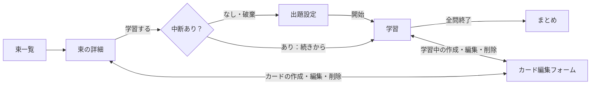

# 暗記カードアプリ（Anki モジュール）要件定義

最終更新: 2026-11-05

## 概要

暗記カードの束を作り、条件を絞って出題・学習できる機能を、既存アプリに `Anki` モジュールとして追加する。データは DB（MySQL）に保存し、ログインユーザー本人だけが参照できる。

- **技術構成**：既存の Slim 4 + Latte + htmx + Alpine.js を使う。React / Next.js は導入しない
- **認証**：既存の GitHub / Google ログインを使う。全データを `user_id` で絞り込む
- **重視すること**：見た目の演出より、軽快さと操作性を優先する

## 機能要件

### 束（デッキ）

- 束を複数作成・名前変更・削除できる
- 束を削除すると、配下のカード・タグ・中断セッションもまとめて削除する

### カード

- 表と裏はそれぞれ何行でも書ける。保存形式はマークダウン
- WYSIWYG で編集できる。画像・コードブロック・数式を使える
- 面ごとにフォントサイズを `large`（既定）/ `normal` / `small` から選べる。情報量が多い面だけ小さくする用途
- タグを複数付けられる
- 新規作成・編集・削除は、カード一覧と学習中のどちらでも同じことができる（同じフォーム部品を使う）

### フラグ（暗記状態）

- 向き（表→裏、裏→表）ごとに状態を持つ
- 状態は「未設定」「暗記済み」「苦手」の3つで、暗記済みと苦手は排他
- ユーザーが手動で切り替える。自動判定はしない。同じフラグをもう一度押すと未設定に戻る
- 操作できる場所は、学習中（今の向きに対して）とカード一覧（両方の向き）

### タグ

- 束ごとに管理する。同じ束の中で名前は重複させない
- 他の束からタグ名だけをインポートできる。カードとの紐付けはコピーしない。同名のタグはスキップする

### 出題設定

| 項目 | 選択肢 |
| --- | --- |
| 向き | 表→裏 / 裏→表（1セッションの中で混ぜない） |
| 対象 | すべて / 暗記済みを除く（未設定と苦手） / 苦手のみ。選んだ向きの状態で判定する |
| タグ | 複数選択でき、AND / OR を切り替える。1つも選ばなければ絞り込みなし |
| 順序 | シャッフル / 登録順 / 登録逆順 |
| 枚数 | 全部 / N 枚。順序を適用したあとの先頭 N 枚を取る |

- 設定を変えると、その場で「該当 n 件 / 出題 m 件」を更新する。0件のときは開始ボタンを無効にする

### 学習セッション

- 開始時に、出題するカード ID の並びを確定して保存する。以降のフラグ変更やタグ変更は、そのセッションの出題に影響させない
- カードはタップ（クリック）で表裏を瞬時に切り替える。切り替えの演出は入れない
- 表示は大きめの文字・左寄せ・縦中央。長い内容は上から通常どおりスクロールする（`margin-block: auto`）。表と裏で高さは揃えない
- 束ごとに中断セッションを1つ保持する。束を開くと「続きから」「破棄して最初から」の2択を出す
- 中断中に削除されたカードはスキップし、編集されたカードは最新の内容を出す
- 最後まで終えたらまとめを表示し、セッションを削除する。まとめには出題数と、そのセッション中に暗記済み・苦手にした枚数を出す

### キーボード操作（PC）

| キー | 操作 |
| --- | --- |
| Space | 表裏を切り替える |
| → / Enter | 次のカード |
| M | 暗記済みの切り替え |
| W | 苦手の切り替え |
| E | 今のカードを編集 |
| N | カードを新規作成 |
| Esc | 編集を閉じる（未保存なら確認） |
| Ctrl / ⌘ + Enter | 編集中に保存する |

- 入力欄やエディタにフォーカスがある間は、学習用のショートカットを無効にする

## 画面一覧

画面は6つで、カードの編集フォームだけはカード一覧と学習画面で共通の部品として使う。

| 画面 | 主な内容 | 備考 |
| --- | --- | --- |
| 束一覧 | 束の作成・名前変更・削除。各束のカード枚数、中断セッションの有無 | サイドバーに「暗記カード」を追加 |
| 束の詳細（カード一覧） | カードの一覧。表の冒頭、タグ、向きごとの状態バッジを表示。フラグの切り替え、新規作成・編集・削除 | 「学習する」ボタンで出題設定へ |
| タグ管理 | タグの追加・名前変更・削除。他の束からタグ名をインポート | 束の詳細画面の中に置いてもよい |
| カード編集フォーム | 表・裏の WYSIWYG エディタ、面ごとのフォントサイズ、タグ、向きごとの状態 | モーダル。スマホでは全画面。学習中も同じものを開く |
| 出題設定 | 向き・対象・タグ（AND / OR）・順序・枚数。「該当 n 件 / 出題 m 件」を即時に更新 | 中断セッションがあれば、先に「続きから / 破棄して最初から」を出す |
| 学習 | カード表示、進捗（例：12 / 30）、「暗記済み」「苦手」「次へ」「編集」「新規作成」「削除」 | 最後のカードのあとにまとめを表示 |

### 画面遷移



中断セッションがあれば「続きから」で学習へ直行し、「破棄して最初から」を選ぶと出題設定へ進む。編集フォームはモーダルで、保存すると開いた画面に戻る。

### 学習中の編集で操作性を保つためのルール

- カード一覧と同じフォーム部品を開く。できる操作に差を作らない
- 開いたら、今表示している面（表か裏）のエディタにカーソルを置く
- 保存後はモーダルを閉じ、同じカードの同じ面に戻る。学習の進捗は変わらない
- 学習中に新規作成したカードは束には追加するが、実行中のセッションには入れない（開始時点で固定、という方針に合わせる）
- 今のカードを削除したら、次のカードへ進む

## データモデル

テーブルは6つ。所有者は `anki_decks.user_id` を起点にたどる。テーブル名には `anki_` を付け、他のモジュールと分ける。外部キーはすべて `ON DELETE CASCADE` にする。

| テーブル | 主な列 | 制約・備考 |
| --- | --- | --- |
| `anki_decks` | `id`, `user_id`, `name`, 作成・更新日時 | `user_id` → `users` |
| `anki_cards` | `id`, `deck_id`, `front_md`, `back_md`（MEDIUMTEXT）, `front_size`, `back_size`（`large` / `normal` / `small`、既定 `large`）, `f2b_status`, `b2f_status`（`none` / `memorized` / `weak`、既定 `none`）, 作成・更新日時 | 登録順は `id` の昇順。INDEX(`deck_id`, `f2b_status`), INDEX(`deck_id`, `b2f_status`) |
| `anki_tags` | `id`, `deck_id`, `name` | UNIQUE(`deck_id`, `name`) |
| `anki_card_tags` | `card_id`, `tag_id` | PRIMARY KEY(`card_id`, `tag_id`)。INDEX(`tag_id`) |
| `anki_images` | `id`, `user_id`, `stored_name`（推測されないランダム名）, `mime`, `size`, 作成日時 | ファイル本体は `public/` の外に置く |
| `anki_study_sessions` | `id`, `deck_id`, `settings`（JSON）, `card_ids`（JSON）, `current_index`, `marked`（JSON）, 作成・更新日時 | UNIQUE(`deck_id`) で束ごとに1つ |

- 状態は向きが2つで固定なので、別テーブルにせず `anki_cards` の2列で持つ。排他は ENUM の1列で保証される
- `settings` には開始時の出題設定（向き・対象・タグ・順序・枚数）を保存する。学習画面では向きだけを読む
- `marked` には「カード ID → そのセッション中に最後に設定した状態」を記録し、まとめの集計に使う
- 回答ログのテーブルは作らない（暗記の判定が手動のため）
- 既存の `todos` には `user_id` がない。Anki では全クエリを所有者で絞る

## URL 設計

すべて `/anki` のグループにまとめ、`AuthMiddleware` を掛ける。他人の束やカードを指定されたら、403 ではなく 404 を返す（存在を漏らさない）。「断片」は htmx が差し替える HTML の一部を指す。

| メソッド | パス | 内容 |
| --- | --- | --- |
| GET | `/anki` | 束一覧 |
| POST | `/anki/decks` | 束を作成 |
| GET | `/anki/decks/{deck}` | 束の詳細（カード一覧） |
| PATCH / DELETE | `/anki/decks/{deck}` | 束の名前変更 / 削除 |
| GET | `/anki/decks/{deck}/cards/new` | 新規作成フォーム（断片） |
| POST | `/anki/decks/{deck}/cards` | カードを作成 |
| GET | `/anki/cards/{card}/edit` | 編集フォーム（断片） |
| PATCH / DELETE | `/anki/cards/{card}` | カードの更新 / 削除 |
| PATCH | `/anki/cards/{card}/status` | 状態の切り替え（`direction`, `status`） |
| GET / POST | `/anki/decks/{deck}/tags` | タグ一覧 / タグを作成 |
| PATCH / DELETE | `/anki/tags/{tag}` | タグの名前変更 / 削除 |
| POST | `/anki/decks/{deck}/tags/import` | 他の束からタグ名をインポート |
| GET | `/anki/decks/{deck}/study` | 出題設定。中断セッションがあれば再開の確認 |
| GET | `/anki/decks/{deck}/study/count` | 出題数（断片。設定を変えるたびに呼ぶ） |
| POST | `/anki/decks/{deck}/session` | セッションを開始（既存のものは破棄） |
| GET | `/anki/decks/{deck}/session` | 学習画面 |
| GET | `/anki/decks/{deck}/session/card` | 今のカード（断片） |
| POST | `/anki/decks/{deck}/session/next` | 次へ進む。最後ならまとめを返してセッションを削除 |
| DELETE | `/anki/decks/{deck}/session` | セッションを破棄 |
| POST | `/anki/images` | 画像のアップロード（JSON で URL を返す） |
| GET | `/anki/images/{name}` | 画像の配信（所有者のみ） |

- 中断するのに専用の操作は不要。「次へ」のたびに `current_index` を保存しているので、画面を閉じれば中断になる
- フラグを学習中に切り替えたときは、`status` を更新したうえで、その束のセッションの `marked` にも記録する

## モジュール構成

既存の `Todo` と同じ仕組みで、`app/Anki/routes.php` を置き、`config/routes.php` の `$modules` に `'Anki'` を追加すれば組み込める。管理するものが多いので、中をサブディレクトリに分ける。

```
app/Anki/
  routes.php                   # /anki グループ。AuthMiddleware を掛ける
  Deck/
    DeckController.php
    DeckRepository.php
  Card/
    CardController.php         # 作成・編集・削除・状態の切り替え
    CardRepository.php
    CardQuery.php              # 対象・タグ(AND/OR)・順序・枚数から SQL を組む
  Tag/
    TagController.php
    TagRepository.php
  Study/
    StudyController.php        # 出題設定・件数・開始・次へ・破棄・まとめ
    StudySessionRepository.php
  Image/
    ImageController.php        # アップロードと、所有者を確かめた配信
    ImageRepository.php
    ImageStorage.php           # ファイルの保存先を抽象化(将来 S3 に差し替え可能)
  Markdown/
    MarkdownRenderer.php       # マークダウン → 安全な HTML
  Domain/
    Direction.php              # enum: F2B / B2F
    CardStatus.php             # enum: None / Memorized / Weak
    FaceSize.php               # enum: Large / Normal / Small
    StudySettings.php          # 出題設定の値オブジェクト(入力の検証もここ)

templates/anki/
  deck/index.latte, deck/show.latte
  card/_form.latte             # 一覧と学習画面で共用する編集フォーム
  tag/index.latte
  study/setup.latte, study/play.latte, study/summary.latte

public/js/anki/
  editor.js                    # Milkdown を必要なときだけ読み込んでマウントする
  study.js                     # 学習画面の Alpine コンポーネントとショートカット
public/css/anki.css

storage/anki/images/           # 画像の実ファイル。Git の対象外
```

- ログイン中のユーザー ID は、既存の `AuthMiddleware` が設定する `$req->getAttribute('user_id')` から取る
- Repository のメソッドはすべて `userId` を受け取り、SQL の中で `anki_decks.user_id` を結合して絞る。コントローラーでの確認漏れを構造的に防ぐため
- テンプレートは既存の `View::page()` と `View::fragments()` を使い、htmx 向けの断片は Latte の `{define}` で切り出す
- 他のモジュールから参照するのは `users` テーブルと `Utilities` だけにし、`Anki` はほかのモジュールに依存しない

## 技術選定とリスク

最大のリスクは「エディタで書いた数式や画像が、学習画面でも同じように表示されるか」。実装に入る前に小さく検証する。

| 項目 | 採用 | 理由・注意 |
| --- | --- | --- |
| WYSIWYG エディタ | Milkdown（Crepe） | マークダウンが前提で、数式・コード・画像が標準で揃う。React 不要。今はビルドの仕組みがないので、バージョンを固定した ESM を CDN から `import()` するか、`editor.js` だけ esbuild でまとめるかを検証で決める |
| マークダウンの表示 | `league/commonmark`（サーバー側） | `html_input` は `escape`、`allow_unsafe_links` は `false` にして XSS を防ぐ。GFM の拡張も使う |
| 数式 | KaTeX（ブラウザ側） | commonmark は `$...$` を知らない。そのままだと `a_1` の `_` が強調として解釈されて壊れる。数式を退避する前処理か、数式対応の拡張が必要 |
| コードの色付け | highlight.js（ブラウザ側） | 表示した断片にだけ適用する |
| 画像 | 自前のアップロード API | Crepe の画像ブロックから `POST /anki/images` を呼ぶ。`finfo` で実体を確認し、JPEG / PNG / WebP / GIF に限る。SVG はスクリプトを含めるので除外 |
| 画像の配信 | PHP 経由 | 所有者を確認してから返す。`X-Content-Type-Options: nosniff` と `Cache-Control: private` を付ける |
| シャッフル | PHP の `shuffle()` | 対象の ID を取ってから混ぜる。`ORDER BY RAND()` は使わない |
| 件数の即時反映 | htmx | 設定フォームに `hx-get` と `hx-trigger="change, input delay:200ms"` を付け、件数の断片だけを返す |

タグの AND / OR は、件数と出題リストで同じ条件を使う。`CardQuery` にまとめる。

```sql
-- OR: 選んだタグのどれかが付いている
AND EXISTS (SELECT 1 FROM anki_card_tags ct
            WHERE ct.card_id = c.id AND ct.tag_id IN (:t1, :t2))

-- AND: 選んだタグがすべて付いている
AND c.id IN (SELECT ct.card_id FROM anki_card_tags ct
             WHERE ct.tag_id IN (:t1, :t2)
             GROUP BY ct.card_id
             HAVING COUNT(DISTINCT ct.tag_id) = 2)
```

### 実装前に検証すること

- [ ] Crepe を Alpine の画面にマウントし、マークダウンを読み書きできるか。CDN と esbuild のどちらで読み込むか決める
- [ ] Crepe が出力する数式の書き方（`$...$` と `$$...$$`）を確認し、サーバー側で壊さずに HTML にできるか
- [ ] 画像を貼り付け、保存し、学習画面で表示するまでを一通り通す
- [ ] 既存アプリに CSRF 対策がない。Cookie の `SameSite=Lax` だけで足りるか、トークンを入れるか判断する

## 実装フェーズと未決事項

カードはマークダウンで保存するので、最初は「テキスト入力とプレビュー」で作り、あとから WYSIWYG に差し替える。学習機能を先に動かせる。

1. **検証**：「実装前に検証すること」の4項目
2. **土台**：マイグレーション、束の管理、カードの管理（テキスト入力とプレビュー）、タグ、フラグ
3. **学習**：出題設定と件数の即時反映、学習画面、学習中の作成・編集・削除、中断と再開、まとめ、キーボード操作
4. **リッチな編集**：Milkdown への差し替え、画像のアップロードと配信、数式、コードの色付け
5. **仕上げ**：タグのインポート、使われなくなった画像の掃除

### 未決事項

- 学習中に「前のカードに戻る」操作は必要か
- 画像のサイズ上限（案：1枚 5MB）と、アップロード時に縮小するか
- 使われなくなった画像をいつ消すか（カード保存時か、定期的なバッチか）
- カード一覧に検索・絞り込み・ページ分割が必要か（束あたり何枚くらいを想定するか）
- 束を削除するとき、確認に束の名前の入力を求めるか（配下をすべて消すため）

### 決定済み（2026-11-05）

- 学習中のカード新規作成は N キー。作成したカードは実行中のセッションに含めない
- 学習中もカードを削除できる
- 束を削除すると、配下のカード・タグ・中断セッションをまとめて削除する
- テーブル名の先頭に `anki_` を付ける
